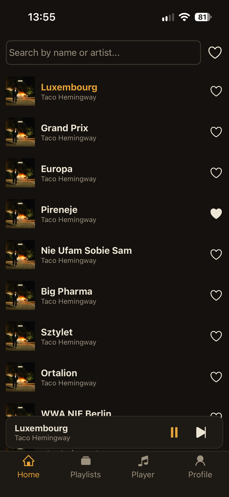
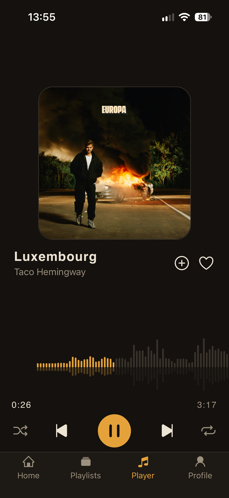
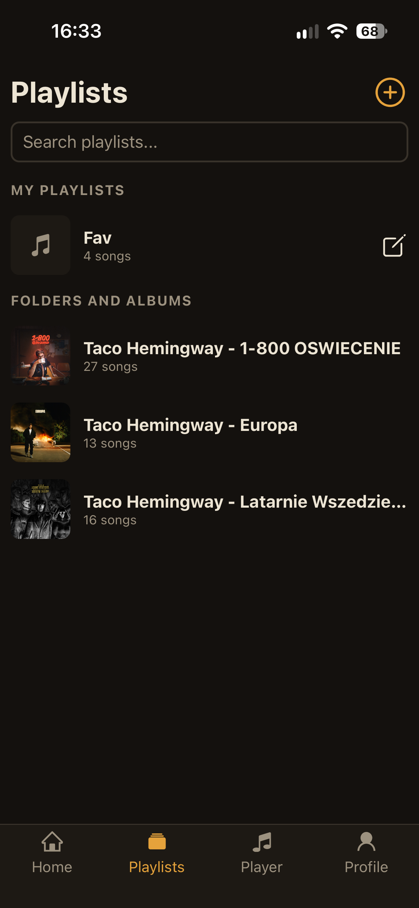
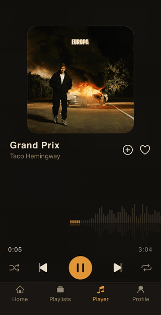
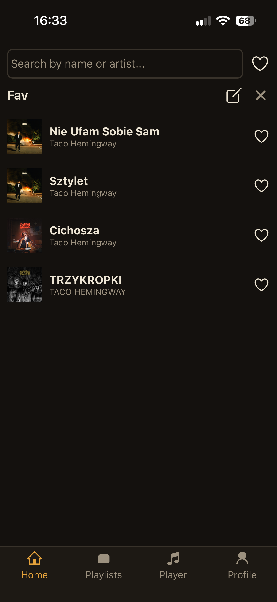
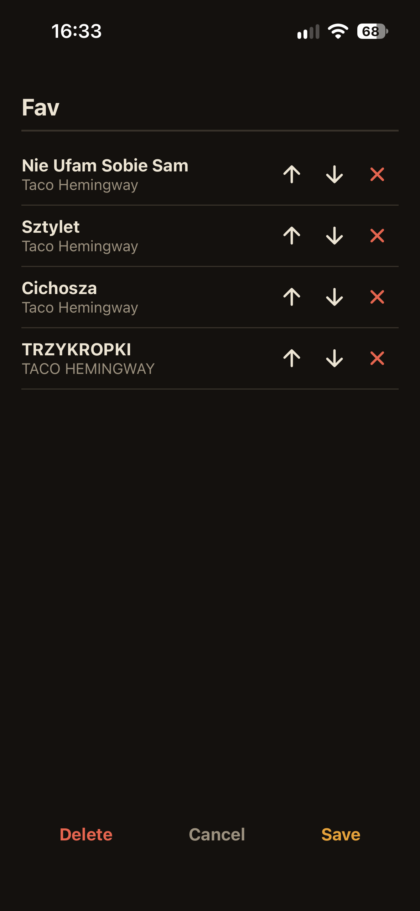
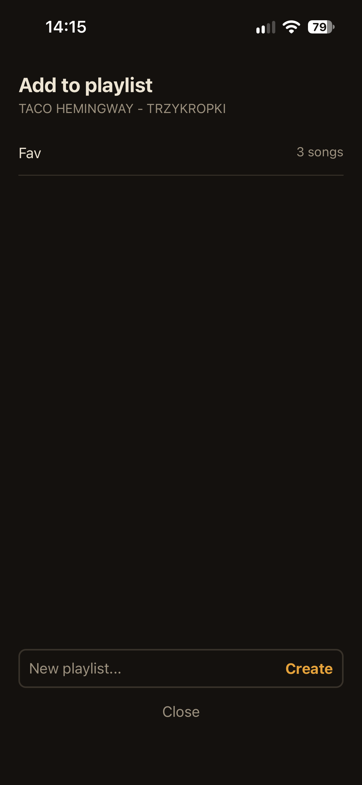

# MusicPlayer

A self-hosted music player. A **React Native (Expo)** app streams MP3 files from a small **Flask** server that runs on your own computer, with a waveform built from the real loudness of each song, folder and custom playlists, and playback that keeps going across screens.


<p align="center">
  
  
  
  
</p>

<p align="center">
  
  
  
</p>

## Features

- **Streaming** your own MP3 library over Wi-Fi (HTTP range requests, so seeking works)
- **Real waveform**: one bar per second of the song, computed from its loudness. Drag it to seek, tap to play or pause
- **Playlists**: every folder in `songs/` is an album/playlist, and you can create **your own playlists**, add songs from the library or the player, and reorder them
- **Library** with search, a favorites filter, pull-to-refresh and loading / error / empty states
- **Queue** with next / previous, shuffle and repeat that follow the selected playlist
- **Mini player** above the tab bar, so music keeps playing when you switch tabs
- Background playback and lock screen controls
- Artist and title from ID3 tags (file name as a fallback), covers from image files or ID3
- Light and dark theme, favorites and theme remembered between launches

## Tech stack

| Part | Technology |
|---|---|
| App | React Native, Expo SDK 57, `expo-audio`, React Navigation (bottom tabs), Reanimated and Gesture Handler for the waveform |
| State | React Context (player, favorites, theme), `AsyncStorage` |
| Server | Python, Flask, `mutagen` (ID3 tags), `miniaudio` and `numpy` (waveform) |
| Tests | `pytest` (27 tests for the server) |

## How it works

```
 Phone (Expo Go)                       Computer
┌───────────────────────┐   HTTP     ┌──────────────────────┐
│ React Native app      │ ────────►  │ Flask server         │
│  PlayerContext        │ ◄────────  │  /media_files        │   ┌─────────────┐
│  FavoritesContext     │  JSON,     │  /get_mp3/<id>       │──►│ songs/*.mp3 │
│  ThemeContext         │  audio     │  /get_waveform/<id>  │   └─────────────┘
└───────────────────────┘            │  /my_playlists       │   ┌──────────────────┐
                                     │  ...                 │──►│ my_playlists.json│
                                     └──────────────────────┘   └──────────────────┘
```

The file system is the library: there is no database. Adding a song means copying a file into `server/songs/`; a sub-folder is a playlist.

## Engineering notes

These are the decisions that were not obvious and why they were made.

- **Waveform from loudness.** The server decodes the MP3 with `miniaudio`, cuts it into one part per second and takes the RMS of each part. Heights are scaled to 15–100 and raised to the power of 3, because otherwise loud modern tracks give almost equal bars. The `duration` returned with the bars is the one the app uses for the progress bar, so bars and time always agree.
- **Progress follows the real player position** (not a timer), so the waveform cannot drift away from the sound. While the finger is on the waveform the two are decoupled, and on release the app seeks to `fraction × duration`.
- **One audio player for the whole app.** A new song only replaces the source of the same player, so two songs can never play at once. `position` changes four times a second, so it lives in its own context and only the screens that draw progress re-render.
- **Song ids are positions, so they are never stored.** Ids shift when files are added or renamed. Favorites are saved as `"artist - title"` and custom playlists as the file path (`Folder/song.mp3`); the server turns them back into current ids on every read.
- **Caching on the server.** ID3 tags and waveforms are cached by `(path, modification time)`, so changing a file invalidates its entry. The song list is rebuilt only when a folder's modification time changes. Cover URLs carry a version (`get_cover/3?v=<mtime>`) and are sent with `Cache-Control`, so the phone keeps them for weeks and fetches a new one only when the cover changes.
- **Custom playlists live on the server** in one JSON file (`my_playlists.json`), not on the phone, so they look the same on every device. There are no user accounts: it is a personal server with one user.
- **Plain React Context instead of Redux.** The shared state is small, and context is easy to follow.
- **Selected playlist travels as a navigation parameter** from the Playlists tab to Home, so the library screen stays the single place that lists songs.

## Getting started

You need Node.js, Python 3, a phone with **Expo Go** and a computer on the same Wi-Fi network.

**1. Server**

```bash
cd server
pip install -r requirements.txt
# copy your .mp3 files into server/songs/ (sub-folders become playlists)
python server.py          # listens on 0.0.0.0:5000
python -m pytest -q       # optional: run the tests
```

The `songs/` folder and `my_playlists.json` are git-ignored: your music stays on your computer and is never committed. Restart the server after changing its code (Flask runs without a reloader).

**2. App**

```bash
npm install
# put your computer's LAN IP into config.js (run `ipconfig` / `ifconfig`, keep port 5000)
npx expo start --lan
```

Scan the QR code with Expo Go. On Windows, allow ports **5000** and **8081** in the firewall.

## Server API

| Endpoint | Returns |
|---|---|
| `GET /media_files` | list of `{id, name, artist, playlist, image}` |
| `GET /playlists` | one `{name, count, image}` per sub-folder of `songs/` |
| `GET /get_mp3/<id>` | the audio file (supports `Range`) |
| `GET /get_waveform/<id>` | `{duration, bars}`: one bar height (15–100) per second of the song, 10 to 600 bars |
| `GET /get_cover/<id>` | cover of a song, or 404 |
| `GET /playlist_cover/<name>` | `cover.*` of a playlist folder, or 404 |
| `GET /my_playlists` | custom playlists as `{id, name, song_ids}` |
| `POST /my_playlists` | create one from `{name}` |
| `PUT /my_playlists/<id>` | replace its `name` and ordered `song_ids` |
| `DELETE /my_playlists/<id>` | delete it |

A song's `id` is its position in the list: files directly in `songs/` first, then each sub-folder in alphabetical order.

Where a song's cover comes from (first match wins): an image named like the song, a picture embedded in the MP3, `cover.*` in the playlist folder, `cover.*` in `songs/`.

## Project structure

```
App.js                    providers (Theme > Favorites > Player) and navigation
Navigation/TabNav.js      bottom tabs: Home, Playlists, Player, Profile
Views/                    Home, Playlists, Player, Profile screens
components/               MiniPlayer, waveform drawing, playlist modals
hooks/                    PlayerContext, FavoritesContext, ThemeContext
themes.js                 light and dark colors (the accent is only for what is playing)
config.js                 server address
server/server.py          the whole Flask server
server/test_server.py     pytest tests (temporary songs folder, real library untouched)
```

## Known limitations

- There is **no authentication**: anyone on your Wi-Fi can use the server and edit playlists. Use it on a trusted network only.
- The first request for a song decodes it for the waveform; the result is cached in memory until the server restarts.
- Custom playlists store file paths, so renaming or moving a song's file removes it from the playlist.
- Lock screen controls and long background playback may need a development build instead of Expo Go.
- The app has no automated tests; only the server is covered.

## Ideas for the future

Uploading songs from the app, authentication with a token, drag-and-drop reordering, a Docker image for the server.

## License

Released under the [MIT License](LICENSE).

Music is not part of this repository. The screenshots show a private collection.